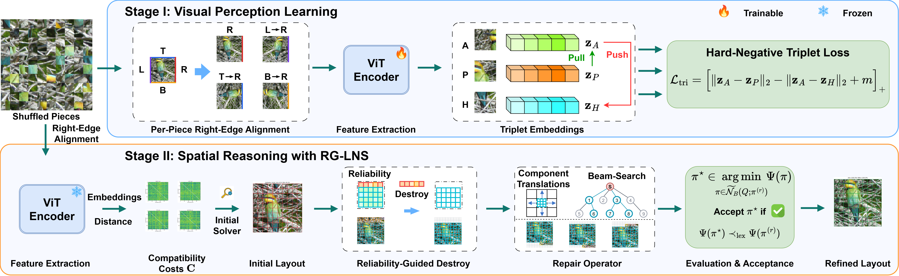
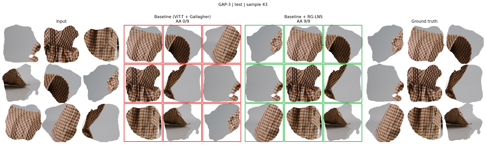
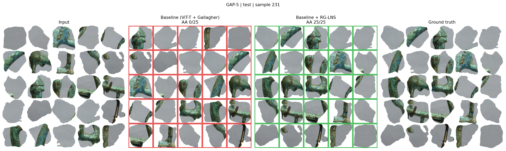
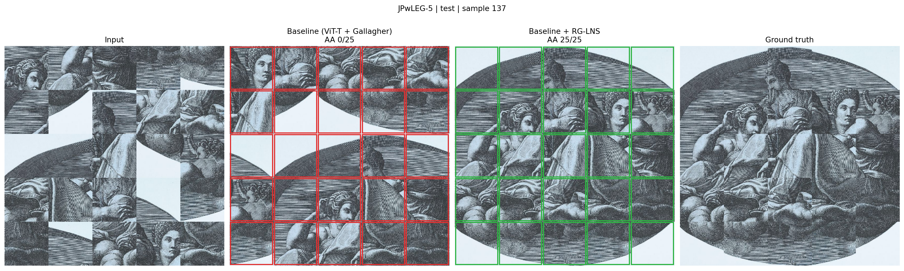
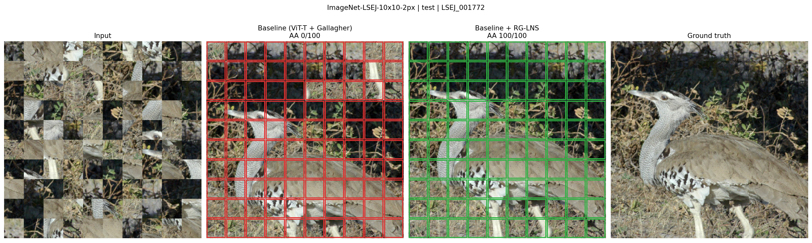
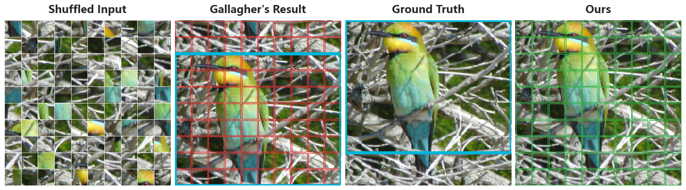
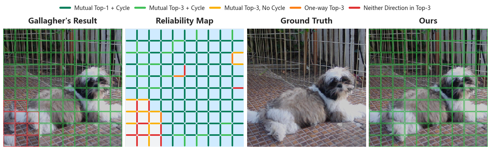

# RG-LNS

**Reliability-Guided Large Neighborhood Search for Eroded Jigsaw Puzzle Reassembly**

**Paper status:** Under review at ICASSP 2027.

[](LICENSE)

RG-LNS combines learned visual compatibility with reliability-guided large
neighborhood search for eroded jigsaw puzzle reassembly. A ViT-Tiny (ViT-T)
model learns directional compatibility between pieces, and RG-LNS refines
initial layouts without retraining the visual model. We evaluate on GAP,
JPwLEG-5, and ImageNet-LSEJ.



<p align="center"><em>Overview of the two-stage RG-LNS framework.</em></p>

## Installation

The verified development environment uses Python 3.10 and the package versions
listed in `requirements.txt`.

```bash
python -m venv .venv
# Windows: .venv\Scripts\activate
python -m pip install -r requirements.txt
```

For CUDA, install the PyTorch build matching the local driver before installing
the remaining requirements.

## Code Layout

```text
RG-LNS/
├── compatibility/          Stage I: ViT compatibility model, scorer, and training
├── data_loaders/            GAP, JPwLEG, and ImageNet-LSEJ adapters
├── initial_solvers/         Gallagher, Pomeranz, LP, and partial-layout completion
├── rg_lns/                  Stage II: the proposed destroy/translate/repair search
├── evaluation/              Metrics and evaluation support
│   ├── commands/            Full evaluation: Baseline and Baseline + RG-LNS
│   ├── common/              Shared arguments, checkpoint lookup, and utilities
│   └── baselines/           Optional standalone baseline evaluations
├── experiments/             Ablation, sensitivity, runtime, and failure analysis
│   └── comparisons/         Optional standalone greedy comparisons
├── scripts/                 Standalone data preparation tools
├── assets/                  Figures used in the documentation
├── datasets/                Local datasets; ignored by Git
│   ├── GAP_fast/
│   │   ├── GAP-3/
│   │   └── GAP-5/
│   ├── ImageNet_LSEJ/
│   └── MET_Dataset/
│       └── JPwLEG-5/
├── checkpoints/             Local weights; ignored by Git
│   ├── pretrained/
│   │   └── vit_tiny_patch16_224_augreg_in21k_ft_in1k_handwritten.pth
│   └── compatibility/
│       ├── gap3_best.pth
│       ├── gap5_best.pth
│       ├── jpwleg5_best.pth
│       ├── lsej_grid10_erode2_best.pth
│       └── lsej_grid10_erode5_best.pth
├── results/
│   ├── reference/            Compact records from submitted experiments
│   └── runs/                 Newly generated runs; ignored by Git
├── evaluate.py               Unified evaluation entry point
├── train_compatibility.py    Stage-I training entry point
├── reproduce.py              Paper-level experiment dispatcher
├── paths.py                  Shared dataset and input-weight locations
├── requirements.txt
└── README.md
```

Stage-I perception is deliberately outside `rg_lns/`. The latter contains
only the proposed layout-correction algorithm and consumes a fixed directional
compatibility tensor plus an initial layout.

## Benchmarks

- **[GAP-3 / GAP-5](https://github.com/OfirShahar/puzzle-flow-matching):**
  public $3\times3$ and $5\times5$ benchmarks with irregular eroded
  fragments. For faster reads, download the storage-repacked `GAP_fast.zip`
  from [Hugging Face](https://huggingface.co/datasets/changxinye/GAP-fast/tree/main)
  and extract it into `datasets/`, yielding `datasets/GAP_fast/`. To repack
  the original data yourself, see the [preparation instructions](docs/reproducibility.md#gap-data-preparation).
- **[JPwLEG-5](https://drive.google.com/drive/folders/1MjPm7ar-u6H5WX6Bw2qshPiYPT_eQCZE):**
  a public $5\times5$ benchmark with large gaps, evaluated under the
  no-fixed-center protocol.
- **[ImageNet-LSEJ](https://github.com/ChangxinYe/ImageNet-LSEJ):** our
  $10\times10$ benchmark derived from ImageNet, with $50\times50$-pixel pieces
  under 2- and 5-pixel erosion.

By default, uncompressed datasets use the following paths:

```text
datasets/GAP_fast/GAP-3
datasets/GAP_fast/GAP-5
datasets/MET_Dataset/JPwLEG-5
datasets/ImageNet_LSEJ/configs
datasets/ImageNet_LSEJ/images
```

Data may also be stored outside the repository or on another drive. Use
`--data-root` in any training or evaluation command to override the default
root (see [Quick Start](#quick-start)). For ImageNet-LSEJ, keep the official
`lsej_dataloader.py` alongside `configs/`, `images/`, `permutations/`, and `splits/`.

## Checkpoints

The six model files are available in the public
[v1.0.0 checkpoint release](https://github.com/ChangxinYe/RG-LNS/releases/tag/v1.0.0).
Download the files you need and place them in the matching subdirectory under
`checkpoints/`:

| Download | Used for |
| :-- | :-- |
| [ViT-Tiny pretrained weights](https://github.com/ChangxinYe/RG-LNS/releases/download/v1.0.0/vit_tiny_patch16_224_augreg_in21k_ft_in1k_handwritten.pth) | Stage I initialization; timm-pretrained weights adapted to the repository's ViT implementation |
| [GAP-3 checkpoint](https://github.com/ChangxinYe/RG-LNS/releases/download/v1.0.0/gap3_best.pth) | GAP-3 evaluation |
| [GAP-5 checkpoint](https://github.com/ChangxinYe/RG-LNS/releases/download/v1.0.0/gap5_best.pth) | GAP-5 evaluation |
| [JPwLEG-5 checkpoint](https://github.com/ChangxinYe/RG-LNS/releases/download/v1.0.0/jpwleg5_best.pth) | JPwLEG-5 evaluation |
| [ImageNet-LSEJ 2px checkpoint](https://github.com/ChangxinYe/RG-LNS/releases/download/v1.0.0/lsej_grid10_erode2_best.pth) | `ImageNet-LSEJ-10x10-2px` evaluation |
| [ImageNet-LSEJ 5px checkpoint](https://github.com/ChangxinYe/RG-LNS/releases/download/v1.0.0/lsej_grid10_erode5_best.pth) | `ImageNet-LSEJ-10x10-5px` evaluation |

For evaluation, only the checkpoint matching the dataset or task is needed;
pass its local path with `--checkpoint` as in the commands below. The
pretrained ViT-Tiny file is needed when training Stage I from scratch.
`checkpoints/` is ignored by Git, so downloaded weights stay local. Training
writes complete run directories under `checkpoints/train_<dataset>/`.

## Quick Start

After installing the requirements and preparing the dataset and matching
checkpoint, run the following from the repository root. Released checkpoints
can be evaluated without retraining Stage I.

### RG-LNS evaluation

Each run reports **Baseline (ViT-T + solver)** and **Baseline + RG-LNS** in
`summary.txt` and `metrics.json`, so no separate baseline run is needed.
Saved figures show the input, both results, and ground truth. Detailed search
records are optional; see the [output guide](docs/reproducibility.md#evaluation-outputs).

```bash
# Gallagher
python evaluate.py GAP-3 gallagher rg-lns --checkpoint checkpoints/compatibility/gap3_best.pth
python evaluate.py GAP-5 gallagher rg-lns --checkpoint checkpoints/compatibility/gap5_best.pth
python evaluate.py JPwLEG-5 gallagher rg-lns --checkpoint checkpoints/compatibility/jpwleg5_best.pth
python evaluate.py ImageNet-LSEJ-10x10-2px gallagher rg-lns --checkpoint checkpoints/compatibility/lsej_grid10_erode2_best.pth
python evaluate.py ImageNet-LSEJ-10x10-5px gallagher rg-lns --checkpoint checkpoints/compatibility/lsej_grid10_erode5_best.pth

# Pomeranz
python evaluate.py GAP-3 pomeranz rg-lns --checkpoint checkpoints/compatibility/gap3_best.pth
python evaluate.py GAP-5 pomeranz rg-lns --checkpoint checkpoints/compatibility/gap5_best.pth
python evaluate.py JPwLEG-5 pomeranz rg-lns --checkpoint checkpoints/compatibility/jpwleg5_best.pth
python evaluate.py ImageNet-LSEJ-10x10-2px pomeranz rg-lns --checkpoint checkpoints/compatibility/lsej_grid10_erode2_best.pth
python evaluate.py ImageNet-LSEJ-10x10-5px pomeranz rg-lns --checkpoint checkpoints/compatibility/lsej_grid10_erode5_best.pth

# Linear Programming
python evaluate.py GAP-3 linear-programming rg-lns --checkpoint checkpoints/compatibility/gap3_best.pth
python evaluate.py GAP-5 linear-programming rg-lns --checkpoint checkpoints/compatibility/gap5_best.pth
python evaluate.py JPwLEG-5 linear-programming rg-lns --checkpoint checkpoints/compatibility/jpwleg5_best.pth
python evaluate.py ImageNet-LSEJ-10x10-2px linear-programming rg-lns --checkpoint checkpoints/compatibility/lsej_grid10_erode2_best.pth
python evaluate.py ImageNet-LSEJ-10x10-5px linear-programming rg-lns --checkpoint checkpoints/compatibility/lsej_grid10_erode5_best.pth
```

Each dataset can be evaluated with `gallagher`, `pomeranz`, or
`linear-programming` initialization.

All examples use the test split. Add `--split val` for validation or
`--max-samples 10` for a short run; `--max-samples 0` evaluates the full split.
Use `--output-dir` to choose where results are saved, or append `--help` to a
command to view all evaluation options.

### Custom data locations

Edit [`paths.py`](paths.py) once to set the three dataset roots and the
compatibility/pretrained weight directories for this machine. Training,
evaluation, and experiments share these defaults. Command-line path arguments
override them for an individual run.

Set `--data-root` to the family root: the directory containing `GAP-3/` and
`GAP-5/` for GAP, `JPwLEG-5/` for JPwLEG, or `lsej_dataloader.py` and the data
subdirectories for ImageNet-LSEJ. For example, with code on `D:` and data on `E:`:

```bash
python evaluate.py GAP-5 gallagher rg-lns --data-root "E:/datasets/GAP_fast" --checkpoint checkpoints/compatibility/gap5_best.pth
```

The same option is available for training:

```bash
python train_compatibility.py GAP-5 --data-root "E:/datasets/GAP_fast"
```

## Training and Experiments

After preparing the datasets and pretrained ViT-Tiny weights, run the following
from the repository root:

```bash
# GAP-3 / GAP-5
python train_compatibility.py GAP-3
python train_compatibility.py GAP-5

# JPwLEG-5
python train_compatibility.py JPwLEG-5

# ImageNet-LSEJ: 2 px / 5 px erosion
python train_compatibility.py ImageNet-LSEJ-10x10-2px
python train_compatibility.py ImageNet-LSEJ-10x10-5px

# Paper-level experiments
python reproduce.py ablation
python reproduce.py sensitivity
python reproduce.py runtime
```

Complete dataset/solver evaluations have explicit modules under `evaluation/commands/`.
Standalone comparisons are separate from the normal evaluation workflow; see
the [experiment instructions](experiments/README.md#standalone-comparisons).
Compact reference results are inventoried in
[`results/reference/README.md`](results/reference/README.md).

## Method Overview

RG-LNS addresses region shift and local ambiguity through reliability-guided
destroy and repair. See [Appendix A](#a-motivation) for examples and
[Appendix B](#b-failure-taxonomy-for-table-1) for the failure-classification
protocol.

1. **Directional compatibility.** The four edges of each piece are mapped to a
   shared canonical orientation and embedded by a frozen ViT-T model.
2. **Reliability-guided destroy.** Mutually strong piece matches supported by
   surrounding pieces are grouped into reliable regions. The internal
   arrangement of the largest reliable region is preserved, while its absolute
   location and the positions of the remaining pieces are released. This
   defines a structured large neighborhood.
3. **Region translation.** The repair operator explores every feasible
   translation of the preserved region, directly addressing region shifts.
4. **Beam-search completion.** For each translation, the remaining pieces are
   placed while multiple layout hypotheses are retained. Newly formed
   adjacencies provide richer compatibility information for distinguishing
   locally ambiguous arrangements.
5. **Evaluation and acceptance.** Completed layouts are evaluated by a fixed
   compatibility objective, and a candidate is accepted only when it strictly
   improves the current layout.

## Main Results

The following tables reproduce the paper's two main comparisons. All metrics
are percentages (higher is better): **PA** is perfect puzzle accuracy, **AA**
is absolute piece-position accuracy, and **SRA** is spatial relationship
accuracy.

Each ViT-T baseline and its RG-LNS row use the same frozen
directional compatibility model; bold values show the result after RG-LNS.
Parenthesized gains are percentage-point improvements over the ViT-T baseline
immediately above, calculated from the displayed values.

### GAP and JPwLEG-5

<table>
  <thead>
    <tr>
      <th rowspan="2" align="left">Method</th>
      <th colspan="3" align="center">GAP-3</th>
      <th colspan="3" align="center">GAP-5</th>
      <th colspan="3" align="center">JPwLEG-5</th>
    </tr>
    <tr>
      <th align="center">PA</th>
      <th align="center">AA</th>
      <th align="center">SRA</th>
      <th align="center">PA</th>
      <th align="center">AA</th>
      <th align="center">SRA</th>
      <th align="center">PA</th>
      <th align="center">AA</th>
      <th align="center">SRA</th>
    </tr>
  </thead>
  <tbody>
    <tr><td><a href="https://doi.org/10.1109/CVPR.2011.5995331">Pomeranz (CVPR 2011)</a></td><td align="right">0.0</td><td align="right">11.6</td><td align="right">8.6</td><td align="right">0.0</td><td align="right">4.1</td><td align="right">3.7</td><td align="right">—</td><td align="right">—</td><td align="right">—</td></tr>
    <tr><td><a href="https://doi.org/10.1109/CVPR.2013.231">GA (CVPR 2013)</a></td><td align="right">0.0</td><td align="right">11.1</td><td align="right">8.5</td><td align="right">0.0</td><td align="right">11.1</td><td align="right">8.5</td><td align="right">—</td><td align="right">—</td><td align="right">—</td></tr>
    <tr><td><a href="https://doi.org/10.1109/TIP.2021.3120052">JigsawGAN (TIP 2022)</a></td><td align="right">4.6</td><td align="right">45.3</td><td align="right">35.9</td><td align="right">0.0</td><td align="right">18.0</td><td align="right">12.0</td><td align="right">—</td><td align="right">—</td><td align="right">—</td></tr>
    <tr><td><a href="https://openaccess.thecvf.com/content/CVPR2024/html/Scarpellini_DiffAssemble_A_Unified_Graph-Diffusion_Model_for_2D_and_3D_Reassembly_CVPR_2024_paper.html">DiffAssemble (CVPR 2024)</a>†</td><td align="right">16.4</td><td align="right">50.5</td><td align="right">43.4</td><td align="right">0.0</td><td align="right">21.9</td><td align="right">14.7</td><td align="right">16.4</td><td align="right">63.0</td><td align="right">—</td></tr>
    <tr><td><a href="https://openaccess.thecvf.com/content/CVPR2024/html/Liu_Solving_Masked_Jigsaw_Puzzles_with_Diffusion_Vision_Transformers_CVPR_2024_paper.html">JPDVT (CVPR 2024)</a>†</td><td align="right">0.0</td><td align="right">11.2</td><td align="right">8.4</td><td align="right">0.0</td><td align="right">3.9</td><td align="right">3.2</td><td align="right">0.0</td><td align="right">4.1</td><td align="right">—</td></tr>
    <tr><td><a href="https://ojs.aaai.org/index.php/AAAI/article/view/32748">ERL-MPP (AAAI 2025)</a></td><td align="right">—</td><td align="right">—</td><td align="right">—</td><td align="right">—</td><td align="right">—</td><td align="right">—</td><td align="right">18.6</td><td align="right">52.7</td><td align="right">—</td></tr>
    <tr><td><a href="https://doi.org/10.1016/j.eswa.2025.126776">FCViT (ESWA 2025)</a>†</td><td align="right">25.2</td><td align="right">60.7</td><td align="right">47.6</td><td align="right">0.0</td><td align="right">20.4</td><td align="right">13.8</td><td align="right">2.5</td><td align="right">43.2</td><td align="right">—</td></tr>
    <tr><td><a href="https://doi.org/10.1007/978-3-032-37281-9_4">PuzLM (ECCV 2026)</a></td><td align="right">0.0</td><td align="right">14.8</td><td align="right">9.9</td><td align="right">0.0</td><td align="right">7.8</td><td align="right">4.5</td><td align="right">32.5</td><td align="right">72.1</td><td align="right">—</td></tr>
    <tr><td><a href="https://openaccess.thecvf.com/content/CVPR2026/papers/Shahar_The_Missing_GAP_From_Solving_Square_Jigsaw_Puzzles_to_Handling_CVPR_2026_paper.pdf">PuzzleFlow (CVPR 2026)</a></td><td align="right">28.5</td><td align="right">62.9</td><td align="right">55.7</td><td align="right">0.3</td><td align="right">29.1</td><td align="right">19.8</td><td align="right">0.0</td><td align="right">29.0</td><td align="right">—</td></tr>
    <tr><td>ViT-T + <a href="https://doi.org/10.1109/CVPR.2012.6247699">Gallagher</a></td><td align="right">24.4</td><td align="right">33.7</td><td align="right">63.2</td><td align="right">15.2</td><td align="right">30.7</td><td align="right">62.4</td><td align="right">39.6</td><td align="right">49.4</td><td align="right">83.4</td></tr>
    <tr><td>↳ + RG-LNS (ours)</td><td align="right"><strong>31.5</strong> <sub>(+7.1)</sub></td><td align="right"><strong>38.9</strong> <sub>(+5.2)</sub></td><td align="right"><strong>68.1</strong> <sub>(+4.9)</sub></td><td align="right"><strong>30.9</strong> <sub>(+15.7)</sub></td><td align="right"><strong>45.6</strong> <sub>(+14.9)</sub></td><td align="right"><strong>74.4</strong> <sub>(+12.0)</sub></td><td align="right"><strong>50.8</strong> <sub>(+11.2)</sub></td><td align="right"><strong>58.3</strong> <sub>(+8.9)</sub></td><td align="right"><strong>89.3</strong> <sub>(+5.9)</sub></td></tr>
    <tr><td>ViT-T + <a href="https://doi.org/10.1109/CVPR.2011.5995331">Pomeranz</a></td><td align="right">30.2</td><td align="right">38.2</td><td align="right">68.0</td><td align="right">24.7</td><td align="right">40.6</td><td align="right">70.9</td><td align="right">49.1</td><td align="right">57.4</td><td align="right">88.1</td></tr>
    <tr><td>↳ + RG-LNS (ours)</td><td align="right"><strong>33.7</strong> <sub>(+3.5)</sub></td><td align="right"><strong>41.1</strong> <sub>(+2.9)</sub></td><td align="right"><strong>70.0</strong> <sub>(+2.0)</sub></td><td align="right"><strong>32.9</strong> <sub>(+8.2)</sub></td><td align="right"><strong>48.7</strong> <sub>(+8.1)</sub></td><td align="right"><strong>75.8</strong> <sub>(+4.9)</sub></td><td align="right"><strong>54.4</strong> <sub>(+5.3)</sub></td><td align="right"><strong>62.2</strong> <sub>(+4.8)</sub></td><td align="right"><strong>90.1</strong> <sub>(+2.0)</sub></td></tr>
    <tr><td>ViT-T + <a href="https://bmva-archive.org.uk/bmvc/2016/papers/paper139/index.html">LP</a></td><td align="right">28.6</td><td align="right">38.6</td><td align="right">65.6</td><td align="right">21.1</td><td align="right">38.0</td><td align="right">65.2</td><td align="right">52.2</td><td align="right">63.6</td><td align="right">86.4</td></tr>
    <tr><td>↳ + RG-LNS (ours)</td><td align="right"><strong>35.5</strong> <sub>(+6.9)</sub></td><td align="right"><strong>43.6</strong> <sub>(+5.0)</sub></td><td align="right"><strong>70.3</strong> <sub>(+4.7)</sub></td><td align="right"><strong>33.7</strong> <sub>(+12.6)</sub></td><td align="right"><strong>49.5</strong> <sub>(+11.5)</sub></td><td align="right"><strong>74.4</strong> <sub>(+9.2)</sub></td><td align="right"><strong>60.7</strong> <sub>(+8.5)</sub></td><td align="right"><strong>69.1</strong> <sub>(+5.5)</sub></td><td align="right"><strong>90.9</strong> <sub>(+4.5)</sub></td></tr>
  </tbody>
</table>

Linked method names cite the original algorithms. Prior-method results are
reported by [PuzzleFlow][puzzleflow], except the JPwLEG-5 results marked †,
which are reported by [PuzLM][puzlm]. JPwLEG-5 uses the no-fixed-center
protocol; the ViT-T combinations and RG-LNS values are from our experiments.

### ImageNet-LSEJ (10 × 10)

<table>
  <thead>
    <tr>
      <th rowspan="2" align="left">Method</th>
      <th colspan="3" align="center">2 px</th>
      <th colspan="3" align="center">5 px</th>
    </tr>
    <tr>
      <th align="center">PA</th>
      <th align="center">AA</th>
      <th align="center">SRA</th>
      <th align="center">PA</th>
      <th align="center">AA</th>
      <th align="center">SRA</th>
    </tr>
  </thead>
  <tbody>
    <tr><td><a href="https://doi.org/10.1109/CVPR.2012.6247699">Gallagher (CVPR 2012)</a></td><td align="right">8.3</td><td align="right">39.9</td><td align="right">62.8</td><td align="right">0.0</td><td align="right">3.1</td><td align="right">23.7</td></tr>
    <tr><td><a href="https://doi.org/10.1109/TIP.2021.3120052">JigsawGAN (TIP 2022)</a></td><td align="right">0.0</td><td align="right">2.1</td><td align="right">2.2</td><td align="right">0.0</td><td align="right">2.1</td><td align="right">2.0</td></tr>
    <tr><td><a href="https://arxiv.org/abs/2211.07771">Edge2Vec (arXiv 2022)</a></td><td align="right">18.2</td><td align="right">55.7</td><td align="right">75.3</td><td align="right">0.2</td><td align="right">10.8</td><td align="right">39.8</td></tr>
    <tr><td><a href="https://openaccess.thecvf.com/content/CVPR2024/html/Liu_Solving_Masked_Jigsaw_Puzzles_with_Diffusion_Vision_Transformers_CVPR_2024_paper.html">JPDVT (CVPR 2024)</a></td><td align="right">0.0</td><td align="right">1.5</td><td align="right">3.4</td><td align="right">0.0</td><td align="right">1.2</td><td align="right">1.5</td></tr>
    <tr><td><a href="https://openaccess.thecvf.com/content/CVPR2024/html/Scarpellini_DiffAssemble_A_Unified_Graph-Diffusion_Model_for_2D_and_3D_Reassembly_CVPR_2024_paper.html">DiffAssemble (CVPR 2024)</a></td><td align="right">0.0</td><td align="right">1.6</td><td align="right">1.4</td><td align="right">0.0</td><td align="right">1.5</td><td align="right">1.3</td></tr>
    <tr><td><a href="https://doi.org/10.1016/j.eswa.2025.126776">FCViT (ESWA 2025)</a></td><td align="right">0.0</td><td align="right">1.0</td><td align="right">7.2</td><td align="right">0.0</td><td align="right">1.0</td><td align="right">12.5</td></tr>
    <tr><td><a href="https://openaccess.thecvf.com/content/CVPR2026/papers/Shahar_The_Missing_GAP_From_Solving_Square_Jigsaw_Puzzles_to_Handling_CVPR_2026_paper.pdf">PuzzleFlow (CVPR 2026)</a></td><td align="right">0.0</td><td align="right">7.3</td><td align="right">4.4</td><td align="right">0.0</td><td align="right">6.1</td><td align="right">3.7</td></tr>
    <tr><td>ViT-T + <a href="https://doi.org/10.1109/CVPR.2012.6247699">Gallagher</a></td><td align="right">39.2</td><td align="right">72.1</td><td align="right">86.8</td><td align="right">5.9</td><td align="right">32.3</td><td align="right">61.1</td></tr>
    <tr><td>↳ + RG-LNS (ours)</td><td align="right"><strong>53.8</strong> <sub>(+14.6)</sub></td><td align="right"><strong>83.9</strong> <sub>(+11.8)</sub></td><td align="right"><strong>91.6</strong> <sub>(+4.8)</sub></td><td align="right"><strong>19.7</strong> <sub>(+13.8)</sub></td><td align="right"><strong>53.1</strong> <sub>(+20.8)</sub></td><td align="right"><strong>74.9</strong> <sub>(+13.8)</sub></td></tr>
    <tr><td>ViT-T + <a href="https://doi.org/10.1109/CVPR.2011.5995331">Pomeranz</a></td><td align="right">48.1</td><td align="right">82.8</td><td align="right">90.5</td><td align="right">16.6</td><td align="right">53.0</td><td align="right">72.7</td></tr>
    <tr><td>↳ + RG-LNS (ours)</td><td align="right"><strong>54.8</strong> <sub>(+6.7)</sub></td><td align="right"><strong>86.7</strong> <sub>(+3.9)</sub></td><td align="right"><strong>92.1</strong> <sub>(+1.6)</sub></td><td align="right"><strong>23.2</strong> <sub>(+6.6)</sub></td><td align="right"><strong>59.8</strong> <sub>(+6.8)</sub></td><td align="right"><strong>77.6</strong> <sub>(+4.9)</sub></td></tr>
    <tr><td>ViT-T + <a href="https://bmva-archive.org.uk/bmvc/2016/papers/paper139/index.html">LP</a></td><td align="right">44.9</td><td align="right">80.9</td><td align="right">88.5</td><td align="right">9.2</td><td align="right">39.2</td><td align="right">63.1</td></tr>
    <tr><td>↳ + RG-LNS (ours)</td><td align="right"><strong>55.9</strong> <sub>(+11.0)</sub></td><td align="right"><strong>85.7</strong> <sub>(+4.8)</sub></td><td align="right"><strong>91.2</strong> <sub>(+2.7)</sub></td><td align="right"><strong>18.6</strong> <sub>(+9.4)</sub></td><td align="right"><strong>50.6</strong> <sub>(+11.4)</sub></td><td align="right"><strong>72.0</strong> <sub>(+8.9)</sub></td></tr>
  </tbody>
</table>

Competing methods on ImageNet-LSEJ were reproduced for the paper. The compact
records for our reported runs are inventoried in
[`results/reference/`](results/reference/README.md).

[pomeranz]: https://doi.org/10.1109/CVPR.2011.5995331
[ga]: https://doi.org/10.1109/CVPR.2013.231
[jigsawgan]: https://doi.org/10.1109/TIP.2021.3120052
[diffassemble]: https://openaccess.thecvf.com/content/CVPR2024/html/Scarpellini_DiffAssemble_A_Unified_Graph-Diffusion_Model_for_2D_and_3D_Reassembly_CVPR_2024_paper.html
[jpdvt]: https://openaccess.thecvf.com/content/CVPR2024/html/Liu_Solving_Masked_Jigsaw_Puzzles_with_Diffusion_Vision_Transformers_CVPR_2024_paper.html
[erlmpp]: https://ojs.aaai.org/index.php/AAAI/article/view/32748
[fcvit]: https://doi.org/10.1016/j.eswa.2025.126776
[puzlm]: https://doi.org/10.1007/978-3-032-37281-9_4
[puzzleflow]: https://openaccess.thecvf.com/content/CVPR2026/papers/Shahar_The_Missing_GAP_From_Solving_Square_Jigsaw_Puzzles_to_Handling_CVPR_2026_paper.pdf
[gallagher]: https://doi.org/10.1109/CVPR.2012.6247699
[edge2vec]: https://arxiv.org/abs/2211.07771
[lp]: https://bmva-archive.org.uk/bmvc/2016/papers/paper139/index.html

On the ImageNet-LSEJ failures used for our analysis, RG-LNS repairs
19.3–42.1% of failures attributed to region shift and 13.9–26.8% of those
attributed to local ambiguity across the three baselines.

## Qualitative Results

Selected examples from GAP-3, GAP-5, JPwLEG-5, and ImageNet-LSEJ, respectively.
Each row shows **Input**, **Baseline (ViT-T + Gallagher)**,
**Baseline + RG-LNS**, and **Ground truth** from left to right.
Green/red boxes mark correct/incorrect absolute piece positions.









## Citation

Citation information will be added with the public paper release.

## Acknowledgments

We thank the authors of the following projects for making their code publicly
available. Their implementations supported our ImageNet-LSEJ baseline
evaluation:

- [JigsawGAN](https://github.com/liru0126/JigsawGAN)
- [JPDVT](https://github.com/JinyangMarkLiu/JPDVT)
- [DiffAssemble](https://github.com/IIT-PAVIS/DiffAssemble)
- [FCViT](https://github.com/HiMyNameIsDavidKim/fcvit)
- [PuzzleFlow](https://github.com/OfirShahar/puzzle-flow-matching)

Other baselines were reproduced by following their original papers.

## License

This project is released under the [MIT License](LICENSE).

## Appendix

### A. Motivation

Even when a complete puzzle layout is incorrect, it can retain many correct
local relationships. Our empirical analysis identifies two dominant failure
modes.

#### 1. Region shift

Some regions preserve the correct relative positions among their pieces but
are displaced as a whole. The cyan outline below marks the same region in the
initial layout and its target location.

<p align="center">
  
</p>

#### 2. Local ambiguity

Multiple neighboring pieces can exhibit high visual similarity, making their
relative spatial positions difficult to infer. The reliability map below
highlights where the available neighboring relationships provide insufficient
support for an unambiguous arrangement.

<p align="center">
  
</p>

### B. Failure Taxonomy for Table 1

This section documents the deterministic sample-level classification used to
produce Table 1 of the paper. The three labels are applied to all failed
predictions from each baseline and form a disjoint partition.

#### Step 1: Absolute-position errors

For a complete failed sample $s$, let $\mathbf{x}_i$ and
$\mathbf{x}_i^{*}$ be the predicted and ground-truth grid coordinates of piece
$i$. The set of pieces at incorrect absolute positions is

```math
\mathcal{W}_s=\{i\in\mathcal{P}:\mathbf{x}_i\neq\mathbf{x}_i^{*}\}.
```

Only failed samples are classified, so $|\mathcal{W}_s|>0$ for every complete
prediction considered below.

#### Step 2: Reliable components

For a currently adjacent pair $(i,j)$ in direction $d$, let
$r_{i\rightarrow j}^{d}$ be the rank of $j$ among the candidate neighbors of
$i$, where rank 1 is best. The adjacency is mutual Top-$K$ when

```math
\max(r_{i\rightarrow j}^{d},\;r_{j\rightarrow i}^{\bar d})\le K,
```

where $\bar d$ denotes the opposite direction. A current $2\times2$ block
provides cycle support only when all four perimeter adjacencies are mutual
Top-$K$. The reliability graph $G_s^{\mathrm{rel}}$ contains the perimeter
edges supported by at least one such complete cycle. Its connected components
with at least $M$ pieces form

```math
\mathcal{C}_s=
\{Q\in\mathrm{CC}(G_s^{\mathrm{rel}}):|Q|\ge M\}.
```

The experiments use $K=3$ and $M=4$.

#### Step 3: Evidence for the two failure modes

For every piece $i$, define the translation needed to move it from its
predicted position to its target position as

```math
\boldsymbol{\Delta}_i=\mathbf{x}_i^{*}-\mathbf{x}_i.
```

A reliable component provides evidence of region shift when all of its pieces
share the same nonzero translation:

```math
\mathcal{C}_s^{\mathrm{shift}}=
\{Q\in\mathcal{C}_s:\exists\,\boldsymbol{\delta}\neq\mathbf{0},\;
\forall i\in Q,\;\boldsymbol{\Delta}_i=\boldsymbol{\delta}\}.
```

Let $\mathcal{R}_s$ contain the pieces covered by shifted reliable components,
and let $\mathcal{L}_s$ contain the pieces outside every reliable component:

```math
\mathcal{R}_s=\bigcup_{Q\in\mathcal{C}_s^{\mathrm{shift}}}Q,
\qquad
\mathcal{L}_s=\mathcal{P}\setminus\bigcup_{Q\in\mathcal{C}_s}Q.
```

We measure how much of the absolute-position error is explained by each type
of evidence:

```math
q_s^{\mathrm{shift}}=
\frac{|\mathcal{W}_s\cap\mathcal{R}_s|}{|\mathcal{W}_s|},
\qquad
q_s^{\mathrm{local}}=
\frac{|\mathcal{W}_s\cap\mathcal{L}_s|}{|\mathcal{W}_s|}.
```

#### Step 4: Ordered sample-level classification

With the dominance threshold $\tau=0.4$, the failure label is assigned in the
following order:

```math
y_s=
\begin{cases}
\text{Region shift},
& q_s^{\mathrm{shift}}\ge\tau,\\[2pt]
\text{Local ambiguity},
& q_s^{\mathrm{shift}}<\tau\ \text{and}\ q_s^{\mathrm{local}}\ge\tau,\\[2pt]
\text{Other failure},
& \text{otherwise}.
\end{cases}
```

The ordered rule makes the two dominant categories mutually exclusive.
Predictions that do not define a complete grid permutation are assigned
directly to **Other failure**.

#### Table 1 results

The following results are obtained on ImageNet-LSEJ ($10\times10$) with
2-pixel erosion. All three baselines use the same frozen ViT-T directional
compatibility.

| Failure type | Gallagher | Pomeranz | LP |
|:--|--:|--:|--:|
| Region shift | 202 (16.6%) | 107 (10.3%) | 135 (12.3%) |
| Local ambiguity | 731 (60.1%) | 742 (71.6%) | 823 (74.7%) |
| Other failures | 283 (23.3%) | 188 (18.1%) | 144 (13.1%) |
| **Total** | **1,216 (100%)** | **1,037 (100%)** | **1,102 (100%)** |

Displayed percentages are rounded to one decimal place.
